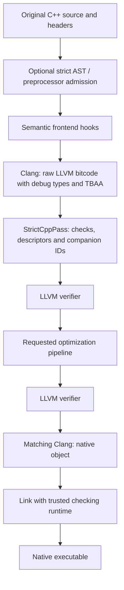

# Strict C++

Experimental compiler source, version **0.4.0** · [MIT license](LICENSE) ·
[Contributing](CONTRIBUTING.md) · [Publishing guide](docs/PUBLISHING.md)

Strict C++ is an experimental compiler for unchanged C++ source. It reuses Clang
for parsing and code generation, preserves selected source semantics in a
frontend plugin, instruments LLVM IR before ordinary optimization, and links a
runtime that tracks object identities, types, bounds and selected lifetimes.

You write ordinary declarations, pointers, references, casts, arrays and
functions. The native backend does not require annotations, replacement pointer
classes, a new source extension or changes to the C++ grammar.

**Version 0.4.0 does not implement a complete C++ safety guarantee.** The broader
backend has executable counterexamples to completeness. Strict mode deliberately
accepts a small subset and rejects unsupported cases. Neither a successful build,
a zero-gap report nor a passing test suite is a proof of compiler/runtime
soundness. This is a research implementation, not a production security boundary.

The project prioritizes **rejecting unsupported cases in strict mode**, including
cases that are otherwise valid C++. The default mode remains the broader
experimental backend so its implemented behavior and remaining holes can be
studied separately.

## Contents

- [Current status](#current-status)
- [Requirements and toolchain](#requirements-and-toolchain)
- [Quick start](#quick-start)
- [Compilation modes](#compilation-modes)
- [Command-line reference](#command-line-reference)
- [The strict source profile](#the-strict-source-profile)
- [Native compiler pipeline](#native-compiler-pipeline)
- [Runtime model and invariants](#runtime-model-and-invariants)
- [The archived AST backend](#the-archived-ast-backend)
- [Reports and intermediate representation](#reports-and-intermediate-representation)
- [Examples](#examples)
- [Diagnostics and exit statuses](#diagnostics-and-exit-statuses)
- [Testing and verification](#testing-and-verification)
- [Repository map](#repository-map)
- [Development guide](#development-guide)
- [Troubleshooting](#troubleshooting)
- [Remaining implementation work](#remaining-implementation-work)
- [Related documentation](#related-documentation)
- [License and contribution](#license-and-contribution)

## Current status

There are two compiler backends and three native admission policies:

| Invocation | Backend/policy | Intended behavior |
| --- | --- | --- |
| `./bin/strict++ program.cpp` | Experimental native backend | Instrument supported operations and report known limitations; broader C++ use may compile. |
| `./bin/strict++ --sc-require-coverage program.cpp` | Native backend with coverage rejection | Reject recorded native gaps, deferred frontend semantics and foreign call targets. |
| `./bin/strict++ --sc-strict program.cpp` | Native backend with `strict-v1` admission | Require the source/preprocessor/driver allowlists as well as coverage rejection. |
| `./bin/strict++ --sc-backend ast program.cpp` | Archived JSON-AST bootstrap | Rewrite temporary main-file copies using Clang source ranges and inject template-based checks. |

These policies have different meanings. Coverage rejection cannot recognize an
unsupported feature that the implementation never reports. Strict admission
adds a default-reject source policy so an unlisted declaration, AST operation,
type, directive or compiler option does not pass merely because its gap count
is zero.

The implementation is validated here on **macOS arm64 with LLVM 21.1.8**.
The native pass requires a 64-bit little-endian target. Other configurations
are not established supported toolchains; `strict-v1` explicitly rejects hosts
outside the tested platform.

The integration suite currently contains 185 tests: 183 pass and two are
documented expected failures in experimental mode. Strict-mode tests separately
verify compilation rejection of those remaining witnesses. The sanitizer
verification command runs nine examples against an ASan/UBSan-instrumented
checking runtime.

The larger differential audit exposes additional missed checks and valid-program
failures beyond those two regression witnesses. See the detailed
[standards and safety audit](docs/TEST_REPORT.md) for the tested modes, exact
outcomes and reproducible failures. The ordinary suite's green status does not
establish the full safety guarantee.

For the precise claim and its limits, read [docs/SAFETY.md](docs/SAFETY.md).
For the complete initial admission rules, read [docs/STRICT.md](docs/STRICT.md).

## Requirements and toolchain

### Required components

| Component | Purpose |
| --- | --- |
| Python 3.10 or newer | Launcher, argument reconstruction, toolchain build helpers, reports and tests. |
| LLVM 21 developer distribution | Matching `clang++`, `opt`, `llvm-config`, LLVM headers and Clang headers for native plugins. |
| Apple command-line developer tools on macOS | Platform SDK located by `xcrun --show-sdk-path`. |
| Host `clang++` with ASan/UBSan support | Needed for `make verify-runtime`; it must understand the selected LLVM bitcode. |
| Make | Convenient targets; the underlying Python scripts can also be invoked directly. |

There are no third-party Python package dependencies. A virtual environment,
package installation, CMake and Ninja are not required by this checkout.

The native runtime is compiled separately as C++17. Experimental native input
programs may select other standards; the differential audit exercises C++98,
C++03, C++11, C++14, C++17, C++20, C++23 and the installed C++26 development
mode, including GNU spellings. User RTTI and exceptions may be disabled for tested native
programs because the runtime is built with its own flags. The strict source
profile accepts C++17/GNU++17 only.

The archived AST helpers use C++17 templates, RTTI and exceptions. That backend
therefore has different source/compiler requirements.

### Install the pinned local LLVM distribution

Run from the project root:

```sh
python3 native/bootstrap.py
```

The bootstrap script:

1. Requires a macOS arm64 host for its pinned download.
2. Downloads the official `LLVM-21.1.8-macOS-ARM64.tar.xz` archive into
   `.strictcpp/toolchains/` if it is not already present.
3. Uses a separate partial-download filename while transferring the archive.
4. Verifies the complete archive against the pinned SHA-256.
5. Extracts the distribution only after verification.
6. Invokes `native/build.py` to build the two plugins and the runtime.

The archive is approximately 1.4 GiB; allow additional disk space for extraction
and build artifacts. The bootstrap does not replace the system compiler.
The pinned digest is:

```text
b95bdd32a33a81ee4d40363aaeb26728a26783fcef26a4d80f65457433ea4669
```

Verify an already downloaded archive without downloading, extracting or building:

```sh
python3 native/bootstrap.py --verify-only
```

The exact release URL, archive name and digest are maintained together in
[native/bootstrap.py](native/bootstrap.py).

### Use an existing LLVM installation

A native developer prefix must contain the compiler tools and development
headers, not just a standalone Clang executable:

```sh
export STRICTCPP_LLVM="/absolute/path/to/LLVM-21.1.8-macOS-ARM64"
python3 native/build.py
```

Toolchain discovery tries the configured prefix first, then suitable local
prefixes under `.strictcpp/toolchains/`. Inspect the printed LLVM path to verify
which installation was selected. Build helpers reject an LLVM major version
other than 21.

Plugins are coupled to the selected LLVM C++ ABI. They must be loaded by the
matching Clang/`opt` tools. A system Clang with the same broad version label is
not automatically interchangeable with a plugin built from another prefix.

### Build products and caching

`python3 native/build.py` creates:

```text
build/native/StrictCppPass.dylib
build/native/StrictCppFrontend.dylib
build/native/runtime.o
build/native/toolchain.json
```

The code has `.so` naming branches for other platforms, but those branches do
not establish tested platform support.

The build cache considers source/header modification times and a fingerprint
containing the selected prefix, LLVM version and compiler modification time.
It is a lightweight cache, not a content-addressed or concurrent build system.
The driver calls the builder as needed, so a separate manual build command is
usually unnecessary after setup.

## Quick start

### Run the provided demonstrations

```sh
make demo
make strict-demo
```

`make demo` builds the experimental native examples. It runs positive programs
normally and explicitly checks that each negative example exits with status 86.
An unexpected successful unsafe execution or an unrelated failing status makes
the target fail.

`make strict-demo` compiles [examples/strict.cpp](examples/strict.cpp) using
`--sc-strict`, writes `build/strict-coverage.json`, and runs the resulting
executable. The example computes a small array sum and returns zero; it does
not call an external printing function.

### Compile a supported strict program

```cpp
unsigned total(unsigned base) {
    unsigned values[4]{};
    for (unsigned i = 0; i < 4u; ++i) values[i] = base + i;
    unsigned sum = 0;
    for (unsigned i = 0; i < 4u; ++i) sum += values[i];
    return sum;
}

int main() {
    return total(3u) != 18u;
}
```

Compile and run the checked-in version:

```sh
mkdir -p build
./bin/strict++ --sc-strict -O2 --sc-report build/strict-coverage.json examples/strict.cpp -o build/strict
./build/strict
```

The source remains unchanged. Admission verifies the profile rules, then the
native pass still inserts runtime checks. A program can satisfy source admission
and subsequently trap for a dynamic bounds/null/initialization violation.

### Explore the broader native backend

```sh
./bin/strict++ -O2 examples/valid.cpp -o build/valid
./build/valid
```

Expected output:

```text
value=42 array=2 heap=7
```

That example uses a valid `void*` round trip, stack indexing, scalar allocation
and `printf`. It intentionally uses experimental mode: `void*` interfaces,
stored pointers, allocation and foreign printing are outside `strict-v1`.

A negative example:

```sh
./bin/strict++ -O2 examples/type_confusion.cpp -o build/type_confusion
./build/type_confusion
```

The executable reports `strictcpp: type-mismatch` at the checked read and exits
86. A shell using automatic nonzero-exit failure handling will treat this
expected checker stop as a failing command; `make demo` handles that convention.

### Invoke from another directory

The executable launcher adds this checkout to its Python import path:

```sh
"/absolute/path/to/Strict C++/bin/strict++" --sc-strict program.cpp -o program
```

No global `PYTHONPATH` or package installation is needed. Relative user paths
and outputs are interpreted from the invocation's working directory.

## Compilation modes

### Experimental native mode

This is the default `--sc-backend native` behavior. It instruments original
translation-unit IR, including emitted definitions from headers, concrete
templates, expanded macros and compiler-generated functions.

Implemented/tested areas include:

| Area | Exercised native behavior |
| --- | --- |
| Typed accesses | Selected scalar, pointer-storage and record/subobject type checks, including enclosing-record identity. |
| Bounds/alignment | Allocation and selected field/row bounds, required alignment and checked GEP offset arithmetic. |
| Lifetime | Automatic scopes, function exit, selected EH unwinding, deletion, reallocation and vector reallocation. |
| Provenance | Companion IDs through supported SSA operations, pointer/integer round trips, memory slots, calls and aggregate pieces. |
| Initialization/const | Per-byte initialization and selected const-store checks, including mutable-field views. |
| Allocation | Recognized scalar/array new, malloc/calloc/aligned allocation, realloc, free and delete-family checks. |
| Placement | Concrete scalar/record lifetime hooks in supported raw backing storage and selected same-type replacements. |
| Union members | Selected scalar activation, inactive-member detection, member generations, simple initializers and supported complete copies. |
| Indirect calls | Lowered function signature/calling convention plus preserved source signatures for selected free/static definitions. |
| Builds | Multiple source inputs, separate native object compilation/linking, response files and ordinary Make dependency files. |

These rows describe tested behavior, not every combination of their features.
Standard-library templates can contribute instrumented IR, but uninstrumented
library binaries remain boundaries. Complex library types may still produce
false positives.

Compatibility compilation may accept a reported gap. It does not silently
allow unknown provenance at an ordinary checked native access: missing authority
still fails when that access is checked.

### Coverage-rejection mode

```sh
./bin/strict++ --sc-require-coverage --sc-report build/coverage.json program.cpp -o build/program
```

This rejects recorded native gaps, deferred frontend sites and foreign call
targets. It also rejects prebuilt/non-source link inputs and linker-controlled
paths whose instrumentation coverage cannot be validated.

Examples of conservatively deferred semantics include source pointer-object
loads, construction, explicit destruction and dynamic casts. Some otherwise safe
uses are therefore rejected.

Reporting is per translation unit. A call whose definition is in another source
can conservatively appear foreign in that unit; this is not a whole-program
link-time resolution or archive-certification implementation.

The legacy flag `--sc-require-main-coverage` is an alias. Its original name
reflects the archived AST backend, where the claim is main-file-only.

### Strict admission mode

```sh
./bin/strict++ --sc-strict program.cpp -o build/program
```

Strict mode adds an explicit source/preprocessor/driver allowlist to the native
coverage policy. It requires:

- The tested host and a supported single-source C++17 job.
- Original-source AST admission before semantic hooks are inserted.
- Accepted preprocessor behavior and compiler options.
- A unique `strict-v1` source-gate acknowledgment.
- Complete, unambiguous frontend and native reports.
- Zero known native gaps, zero deferred frontend sites and no foreign symbols.
- A successful final link with the checking runtime.

It cannot fall back to the AST backend or permit untracked storage. Unknown
language constructs and options are rejected even if they are valid C++.

### Archived AST mode

```sh
./bin/strict++ --sc-backend ast program.cpp -o build/program
```

This mode needs no LLVM developer package. It uses a runnable Clang with a
JSON AST dump, writes temporary checked source copies and injects
`runtime/strictcpp.hpp`.

It covers main-file source ranges only. It does not offer the native source
gate, complete header/macro coverage, native shadow IDs or complete provenance.
Its reference remains in [docs/AST_BACKEND.md](docs/AST_BACKEND.md).

## Command-line reference

Private `--sc-*` options are consumed by the launcher. Other supported options
are reconstructed into Clang jobs. This is a Clang-shaped experimental driver,
not a complete drop-in implementation of all Clang options or job graphs.

| Option | Meaning |
| --- | --- |
| `--sc-backend native` | Select the default LLVM backend. |
| `--sc-backend ast` | Select the archived source-rewriting backend. |
| `--sc-strict` | Enable `strict-v1` admission and coverage rejection; native only. |
| `--sc-require-coverage` | Reject reported gaps/deferred sites/foreign targets, without the strict source allowlist. |
| `--sc-require-main-coverage` | Legacy alias for coverage rejection. |
| `--sc-report FILE` | Write JSON evidence when the current build stage can produce it. |
| `--sc-emit-dir DIRECTORY` | Preserve native `.strict.bc` or AST-generated `.strict.cpp` artifacts. |
| `--sc-clang PATH` | Select the AST backend's Clang executable. |
| `--sc-allow-untracked` | AST-only weakening option allowing unknown storage; incompatible with native/strict enforcement. |
| `--sc-quiet` | Hide normal instrumentation summaries; failures still report diagnostics. |
| `--sc-version` | Print implementation version without compiling a program. |
| `--sc-help` | Print the driver help. |

### Environment variables

| Variable | Use |
| --- | --- |
| `STRICTCPP_LLVM` | Preferred LLVM 21 developer prefix for native build/tools. |
| `STRICTCPP_CLANG` | AST backend compiler, equivalent to `--sc-clang`. A nondefault value is rejected in native mode. |
| `STRICTCPP_SANITIZER_CXX` | Host compiler used by `native/verify_runtime.py` for sanitizer runtime builds and bitcode linking. |

The toolchain, SDK and host build environment are trusted components. Strict
option admission does not make a compromised compiler installation trustworthy.

### Supported ordinary build forms

Using your own source files, experimental native mode can compile separately:

```sh
./bin/strict++ -c first.cpp -o build/first.o -MMD -MF build/first.d
./bin/strict++ -c second.cpp -o build/second.o
./bin/strict++ build/first.o build/second.o -o build/program
```

Joined `-oFILE`, `-MFFILE`, `-MTTARGET` and `-MQTARGET` forms are normalized.
Dependency output names the user-visible target rather than temporary bitcode.
Use separate dependency files when compiling multiple source units.

Response files are expanded before source classification and policy checks:

```sh
./bin/strict++ @build/compiler-options.rsp
```

Nested response inclusion is bounded. The wrapper does not delegate hidden
unvalidated response contents to a later compiler job.

The exposed tested optimization levels are `-O0/-O1/-O2/-O3/-Os/-Oz`.
Native source analysis intentionally emits frontend IR with O1 metadata and
disabled LLVM optimization passes, then applies the selected level afterwards.
O0 requests undefine `__OPTIMIZE__`; this is not a perfect reproduction of every
compiler macro/option behavior.

Strict mode excludes separate compilation, preprocessing-only/assembly jobs,
multiple source units, raw linker controls and compiler/pass forwarding.
PCH, modules, LTO, cross-compilation and arbitrary build-system flags remain
unfinished areas rather than silently supported forms.

## The strict source profile

[docs/STRICT.md](docs/STRICT.md) is the detailed admission contract. The main
rules are summarized here so a new user can predict common rejection reasons.

### Types and storage

Supported object types are `bool`, `int`, `unsigned int`, `long`,
`unsigned long`, `long long`, `unsigned long long`, their supported const
forms, and small positive fixed arrays of those types.

Pointers can appear as temporary expressions derived from admitted objects,
for example `*&value`, `array[index]`, a checked pointer offset, a null
conversion or a conditional selection. Pointer/reference variables and pointer
interfaces are rejected. Their exact storage/source-type/lifetime semantics are
not yet completely enforced.

Automatic objects and constant-initialized internal static data are admitted.
Externally visible data is rejected to avoid interposing runtime symbols.
TLS and dynamic static initialization are rejected.

### Functions and control flow

Admitted functions use scalar parameters and scalar/`void` results, up to eight
parameters, direct calls and an acyclic call graph. `main` takes no arguments.
Unknown/builtin/indirect/foreign calls cannot widen this interface.

Supported statement forms include blocks, declarations, returns, `if`,
`while`, `do`, `for`, `break` and `continue`, with selected conditional,
comparison, assignment, logical and bitwise expressions.

Namespaces, templates, classes, unions, enums, lambdas, exceptions, assembly
and unlisted AST forms are not part of the initial profile. Most standard-library
headers consequently fall outside it, even when the experimental backend
successfully exercises a particular library path.

### Arithmetic and sequencing

Unsigned arithmetic is admitted where defined by the listed operator rules.
Unsigned increment/decrement and assignment side effects must occur in
supported standalone contexts, including the allowed for-loop positions.

Signed arithmetic generally requires a Clang-proven constant expression without
side effects or undefined behavior. Division/remainder additionally admits a
dynamic signed numerator with a proven positive constant divisor; unsigned
division/remainder needs a proven nonzero constant divisor.

Shifts require an unsigned result and a proven constant count inside the type
width. Pointer differences and ordered pointer comparisons are rejected;
supported offsets use the native GEP checks.

The driver forces missing-return and unsequenced-modification diagnostics after
user warning controls. Silencing a warning cannot make those cases pass strict
admission.

### Preprocessor and resource limits

User pragmas, `_Pragma` expansions and identification directives are rejected.
The compiler-owned predefines buffer is exempt by physical file ID, so a
`#line` filename cannot impersonate it. Newline/carriage-return compiler
arguments are rejected to prevent macro options from injecting directives into
that buffer.

Each array is limited to 1024 bytes. Each function has a 1024-byte budget for
declared locals plus the implementation's per-declaration tracking allowance.
The translation unit is limited to 4096 statement/expression nodes.

These are conservative implementation limits. They do not prove native stack
bounds, termination or resource-exhaustion behavior.

## Native compiler pipeline



### 1. Driver reconstruction

[strictcpp/driver.py](strictcpp/driver.py) expands response files, normalizes
joined options, separates private options, protects the direct source output
path and creates an invocation-scoped temporary directory.

[strictcpp/policy.py](strictcpp/policy.py) applies the stricter job allowlist
when requested. [strictcpp/native_driver.py](strictcpp/native_driver.py)
orchestrates the native tools and validates their evidence.

### 2. Source admission and semantic preservation

[native/strict_profile.h](native/strict_profile.h) validates original source
before mutation. Its declaration/statement/type/operator switches reject
unlisted cases, and a final call-graph pass rejects direct/mutual recursion.

[native/frontend.cpp](native/frontend.cpp) preserves selected facts that
ordinary IR loses:

- Concrete placement construction and allocated source types.
- Base-to-derived pointer relationships and nonzero base adjustments.
- Writable views of mutable fields within const records.
- Signed-character read/write intent.
- Selected scalar union member selection, activation and initialization.
- Source function signatures for free/static definitions and selected indirect calls.

Synthetic hooks have implicit compiler declarations and noexcept signatures.
Their runtime stubs return the same pointer bits. The LLVM pass interprets the
events and supplies the actual checks and identities.

Runtime-only conditionals choose the original typed pointer expression during
constant evaluation. Keeping the void-pointer conversion solely in the runtime
branch preserves tested constexpr/noexcept behavior.

### 3. Raw IR generation

Clang emits standalone debug information and TBAA while LLVM passes are disabled.
Debug metadata provides declared object/field/base layout; TBAA supplies selected
access and enclosing-record identity.

Some source information is already absent or ambiguous at this stage. Metadata
is an implementation input, not a complete C++ object-model specification.
That is why the semantic hooks and remaining source-type limitations matter.

### 4. Early LLVM instrumentation

[native/pass.cpp](native/pass.cpp) snapshots original instructions and inserts:

- Object/frame registration and lifetime-end operations.
- Pre-load/pre-store bounds, alignment, type and initialization checks.
- Companion object IDs for eligible SSA values and aggregate pieces.
- Pointer-storage shadows after stores and matching recovery after loads.
- Checked GEP offset accumulation and selected subobject/row narrowing.
- Exact-target call transport and selected indirect-call validation.
- Modeled allocation/deallocation/realloc/copy/fill operations.
- A module constructor for global/function registration and static pointer shadows.

The checker runs before the requested default optimization pipeline. LLVM
verification runs after instrumentation and after optimization. Newly injected
runtime calls are not recursively instrumented.

The pass removes the GEP `inbounds` flag before its checks so invalid offsets can
reach diagnostics rather than immediately becoming poison due to that flag.
This is not a complete treatment of all optimizer-visible C++ undefined behavior.

### 5. Native object generation and linking

The selected Clang consumes checked bitcode and creates native objects. The
driver links one separately compiled `native/runtime.cpp` object per executable.

User source flags/macros are not applied to the runtime build. Runtime code must
not be instrumented by its own checker or allocate metadata through user
replacement new/delete.

## Runtime model and invariants

### Descriptors and object records

[native/abi.h](native/abi.h) defines the shared C-linkage interface. It is a C++
header used by the implementation, not a user annotation API.

`ScType` describes one element: normalized name, element size, category flags
and a field list. `ScField` records a child offset, repetition count and child
descriptor. The pass manually constructs matching LLVM layouts; changing the
header requires coordinated pass/runtime changes.

An object record stores:

- Its unique ID and owning frame where applicable.
- Base address and actual storage extent.
- Storage/allocation family.
- Available declared layout and source registration location.
- Liveness, initialized-byte state and selected raw typed slots.
- Placement parent and selected union states.

Storage-family values are 0 stack, 1 scalar new, 2 global, 3 calloc,
4 array new and 5 C allocation. Descriptor category flags are a different
bitmask; allocation family and source type answer different questions.

### Object identity versus address

IDs are assigned independently of addresses. Retired records are retained.
Allocating a new object at the same numeric address produces a new generation;
old pointers must not obtain the new ID merely because their bits still match.

Selected transparent same-type replacement can record an explicit forwarding
relationship. Arbitrary address reuse never creates one.

This distinction is tested with deterministic replacement allocation, not only
with allocator-dependent chances of address reuse.

### Capabilities and subobjects

A capability refers to an existing object with a narrower start/extent. It can
also retain a selected mutable type view and union member guards.

Selecting a record field or matrix row can narrow authority. This prevents a
pointer into one row from reading a neighboring row simply because the complete
matrix allocation contains both.

Capabilities do not allocate storage or change the machine pointer. Their IDs
travel alongside values in compiler-inserted metadata.

### Shadow storage and ABI pieces

The runtime associates a pointer/integer storage slot with its actual bits and
transported ID. A load recovers that ID only if its bits still match. Overlapping
writes invalidate affected shadows, including partial pointer writes.

An ordinary missing shadow produces ID zero. It does not trigger a general
live-address search. Otherwise an expired pointer could silently acquire a new
allocation's identity after address reuse.

Static pointer initializers use a separate lazy-resolution marker to tolerate
module registration order. Hosted argv and selected foreign entries/returns
also have explicit limited resolution rules; these are boundaries, not a
general unknown-pointer permission.

Aggregate and wide-integer ABI pieces retain independent IDs. A single ID for
an entire returned struct would lose the identity of each embedded pointer.

### Calls, frames and exception cleanup

Per-thread pending-call records identify the exact target and carry argument/
return IDs without changing its public calling convention. Instrumented entry
claims only a matching call. A foreign callback cannot consume an unrelated
outer pending call.

Frames own automatic object registrations. Normal return retires that storage;
selected landing-pad handling trims abandoned child frames and pending calls.
Heap/global storage has a different lifetime and is not retired on ordinary
function return.

This covers tested EH paths, not every exception allocation, cleanup, coroutine
or nonlocal-control-transfer protocol.

### Allocation, placement and deallocation

Recognized allocation calls create storage registrations. Family checks reject
cases such as malloc/delete and array-new/scalar-delete mismatches.

Replaceable C++ deallocation callbacks retain the exact root identity until
return. A TLS permission permits a nested free for that callback, including
standard sized-delete forwarding. Instrumenting an allocator body still does
not verify that the returned storage has its claimed extent; the contract
remains a reported gap.

Successful realloc transfers the supported preserved metadata prefix to a fresh
ID, including an in-place result. Failure leaves the original registration live.
Non-null `realloc(p, 0)` is explicitly rejected because its platform-dependent
deallocation behavior is not modeled.

Concrete supported placement construction creates a typed child in raw backing
storage. Ending the owner also ends children. Full typed-storage reuse,
transparent replacement, launder, array-cookie and destruction rules remain
unfinished.

### Union members

Selected scalar unions track active member index and generation per union
address/type. A capability captures that generation, so identical member types
and shared addresses do not merge distinct lifetimes.

Supported simple assignment can activate a member. Compound assignment needs
an already live old value. An arbitrary store through a pointer to an inactive
member does not receive activation permission.

Simple initializers and supported complete copies carry member state.
Assignment into the member already active preserves its lifetime. Copying from
compiler constant data can preserve initializer-selected destination state;
raw byte copies without source union metadata cannot reconstruct arbitrary
member identity.

Record/array members, common initial sequences and all replacement/ABI
interactions are incomplete. Union use remains a coverage gap and strict-v1
rejects it.

### Initialization, const and synchronization

Selected value reads require initialized bytes. Stores and supported bulk copies
update initialization separately from type/lifetime identity. A byte being
initialized does not establish that every typed interpretation is valid.

Const checks are selected rather than complete. Mutable-field views allow the
specific writable field without making the whole const record writable.

The registry uses a recursive mutex for metadata consistency; call transport
is thread-local. The lock is released before the actual user load/store/copy.
There is a check/use gap under concurrent lifetime changes. Atomic RMW/cmpxchg,
signals, TLS lifetime and general race safety are not comprehensively enforced.

Runtime containers use a malloc/free allocator to avoid instrumented user
new/delete recursion. Metadata is retained through teardown. Exhaustion aborts;
no production performance or bounded-metadata-space claim is made.

## The archived AST backend

[strictcpp/instrument.py](strictcpp/instrument.py) consumes Clang JSON ranges
and edits original bytes into temporary source copies. Byte offsets preserve
UTF-8 source/path handling. Nested `Slice` references allow wrappers to compose;
crossing/conflicting ranges cause an error rather than an unsafe guess.

Generated helpers cover selected pointer/reference/subscript accesses,
declarations, allocations, deletion and record descriptions. ADL-discovered
friends describe private fields and bases without making them public. RAII
guards register supported lifetimes and preserve tested local destructor order.

Unevaluated expressions and address-only `&*p` are not converted into reads.
C++17 operand ordering and array-bound single evaluation have dedicated tests.
A `#line` directive maps diagnostics back to the original source.

The archived runtime uses an address/RTTI region registry. It lacks native
shadow-ID transport, complete per-byte initialization and complete allocation
provenance. Header/macro ranges, range-for storage, placement construction and
other unsupported cases are reported as limitations.

`--sc-allow-untracked` weakens this backend explicitly. Native mode rejects
the option, and strict mode cannot select the AST backend at all.

## Reports and intermediate representation

### JSON reports

```sh
./bin/strict++ --sc-strict -O2 --sc-report build/coverage.json examples/strict.cpp -o build/strict
```

A representative native strict report has this shape:

```json
{
  "version": "0.4.0",
  "backend": "llvm-native",
  "status": "accepted",
  "mode": "strict",
  "profile": "strict-v1",
  "translation_units": [
    {
      "source": "/work/strictcpp/examples/strict.cpp",
      "backend": "llvm-native",
      "scope": "all IR definitions, including headers, templates, and expanded macros",
      "source_policy": "strict-v1",
      "counts": {
        "functions": 2,
        "accesses": 20,
        "object_sites": 6,
        "known_gaps": 0,
        "frontend_deferred": 0
      },
      "foreign_symbols": [],
      "limitations": [
        "foreign binary code and callbacks are trust boundaries",
        "object-model and source-type information can be lost before IR; no full soundness claim"
      ]
    }
  ]
}
```

Paths and counters depend on the actual source/toolchain. Counts describe static
instrumentation sites, not the number of runtime executions.

| Field | Interpretation |
| --- | --- |
| `version` | Implementation version, not a conformance/ABI certificate. |
| `backend` | Native report family; AST reports use their separate older schema. |
| `status` | Recorded build-stage outcome when the report is written. |
| `mode/profile` | Whether strict admission was requested and which source profile applied. |
| `source_policy` | Per-unit policy name, or `experimental`. |
| `known_gaps` | Recognized limitations; not a complete count of every possible safety hole. |
| `frontend_deferred` | Conservatively deferred source semantic sites. |
| `foreign_symbols` | Declared unmodeled call targets observed by the pass. |

Strict frontend rejections can write `status: rejected` with diagnostic text
before any IR translation-unit report exists. Other early driver/tool failures
can occur before a report is created or refreshed. **The process exit status
is authoritative.** An existing report or executable alone does not establish
that the latest requested build succeeded.

The driver requires unique anchored stage summaries and validates the foreign
symbol list. Missing/duplicated summaries, a missing strict-gate acknowledgment
or malformed evidence prevent unchecked linking.

### Preserve and inspect bitcode

```sh
./bin/strict++ --sc-strict --sc-emit-dir build/ir examples/strict.cpp -o build/strict
.strictcpp/toolchains/LLVM-21.1.8-macOS-ARM64/bin/llvm-dis build/ir/0-strict.strict.bc -o build/ir/strict.ll
```

Files follow `N-source-stem.strict.bc` naming. The preserved bitcode is checked
and processed through the selected optimization level. Inspect `__sc_*` calls,
type descriptor globals, companion PHIs and module initialization in the
disassembled IR.

Use the matching LLVM tools. A different `llvm-dis` or host compiler may reject
the bitcode version or interpret incompatible IR features.

AST mode instead preserves `N-source-stem.strict.cpp` generated copies in the
requested directory. Original input files remain the analysis source and are
not replaced by these artifacts.

## Examples

| Source | Mode | Expected result |
| --- | --- | --- |
| [valid.cpp](examples/valid.cpp) | Experimental native | Print `value=42 array=2 heap=7`; exit 0. |
| [heap_array.cpp](examples/heap_array.cpp) | Experimental native | Print `30`; exit 0 after delete[]. |
| [replacement_allocator.cpp](examples/replacement_allocator.cpp) | Experimental native | Replacement new/delete delegates to C allocation; exit 0. |
| [union_members.cpp](examples/union_members.cpp) | Experimental native | Supported initialization/copy/member-switch checks; exit 0. |
| [type_confusion.cpp](examples/type_confusion.cpp) | Experimental native | `type-mismatch`; exit 86. |
| [vector_lifetime.cpp](examples/vector_lifetime.cpp) | Experimental native | `expired-object` after reserve; exit 86. |
| [union_lifetime.cpp](examples/union_lifetime.cpp) | Experimental native | `union-inactive-member` through saved pointer; exit 86. |
| [character_alias.cpp](examples/character_alias.cpp) | Experimental native | `type-mismatch` for signed-char access; exit 86. |
| [strict.cpp](examples/strict.cpp) | Strict-v1 | Checked unsigned array computation; exit 0. |

Many positive experimental examples are intentionally rejected by strict-v1
because they exercise interfaces or types outside its initial subset.

## Diagnostics and exit statuses

A native checker diagnostic includes the original access location, reason,
requested type where available, and the recorded object origin:

```text
/path/type_confusion.cpp:<line>: strictcpp: type-mismatch at 0x...
  requested: float
  object #... (int, 4 bytes) registered at /path/type_confusion.cpp:<line>
```

Record names may be RTTI-mangled or normalized metadata names rather than
user-friendly source spellings. The archived RTTI runtime has separate
demangling support.

| Reason | Typical interpretation |
| --- | --- |
| `type-mismatch` | Access type or enclosing record path does not match tracked storage. |
| `null-access` | A value access uses address zero. |
| `missing-provenance` / `unknown-provenance` | The pointer has no usable transported authority. |
| `expired-object` | The recorded storage generation has ended. |
| `out-of-bounds` | Access does not fit the allocation extent. |
| `subobject-out-of-bounds` | Access does not fit its narrower field/row capability. |
| `misaligned-access` | Address violates required alignment. |
| `uninitialized-read` | A selected value read needs bytes not marked initialized. |
| `write-to-const` | A selected store attempts to modify protected const storage. |
| `union-inactive-member` / `expired-union-member` | Member selection/generation is no longer valid. |
| `index-overflow` | Offset/address arithmetic cannot be represented safely. |
| `delete-kind-mismatch` / `interior-delete` / `delete-non-heap` | A selected deallocation contract is invalid. |
| `call-type-mismatch` / `null-call` / `unregistered-call-target` | Indirect call validation failed. |
| `unsupported-storage-reuse` / `unsupported-zero-realloc` | The runtime refuses a known unmodeled operation. |

Strict source errors use `strictcpp: strict profile rejects ...` where the
admission gate emits the diagnostic. Clang can also reject first, for example
with a forced missing-return or unsequenced-modification error.

Exit conventions:

- 0: the requested build or demonstrated program succeeded.
- 2: a driver/policy error handled by the Python launcher.
- Other compiler/linker statuses: propagated from the failing tool, commonly 1.
- 86: a runtime checker stop before the diagnosed checked operation.
- Signals/other statuses: can indicate OS failure, resource exhaustion,
  sanitizer failure or unmodeled behavior; they are not interchangeable with 86.

Runtime stops use `_Exit` after flushing diagnostics. User destructors and
atexit handlers are not run after a checker failure, because they could revisit
the invalid state.

## Testing and verification

### Integration suite

```sh
make test
```

Or run a focused group:

```sh
make test-native
make test-ast
python3 -m unittest discover -s tests -p test_driver_integrity.py -v
python3 -m unittest discover -s tests -p test_strict.py -v
```

| Suite | Responsibility |
| --- | --- |
| [test_compiler.py](tests/test_compiler.py) | Explicit AST-backend rewriting, RAII, ordering, Unicode and main-file coverage regressions. |
| [test_native.py](tests/test_native.py) | Native IR/runtime integration, optimization, provenance, allocation, headers/templates and builds. |
| [test_semantics.py](tests/test_semantics.py) | Source distinctions erased by lowering: character accesses, constant evaluation and union members. |
| [test_driver_integrity.py](tests/test_driver_integrity.py) | Missing/ambiguous reports and alternative source/link paths. |
| [test_strict.py](tests/test_strict.py) | Positive subset examples, unsupported source/configuration rejection, gate evidence and runtime traps. |
| [test_known_limits.py](tests/test_known_limits.py) | Executable counterexamples retained as expected failures in experimental mode. |

Tests compile real C++ sources, run native executables and inspect the intended
diagnostic. Temporary inputs/artifacts are isolated, and source-preservation
checks protect against accidental rewriting of original files.

The two expected failures are part of the evidence against completeness:

1. Explicit destructor calls do not fully retire accessible object lifetime.
2. Character-pointer storage types can be conflated by debug/TBAA metadata.

An unexpected success deliberately fails that suite so the behavior can be
reviewed before removing the expected-failure marker. These witnesses are not
an exhaustive inventory of remaining holes.

### Standards, optimizers and edge-case audit

Run the larger audits separately and in this order:

```sh
make test-standards
make test-boundaries
```

These targets return nonzero when any compatibility or safety expectation fails,
including a documented limitation. They are outside normal unittest discovery;
the integration suite's expected failures do not turn audit failures into passes.
Run the targets serially because they share the native toolchain build cache.
The recorded findings and exact scope are in [TEST_REPORT.md](docs/TEST_REPORT.md).

The main audit crosses the applicable cases in
[standards_cases.py](tests/standards_cases.py) with ISO and GNU modes for C++98,
C++03, C++11, C++14, C++17, C++20, C++23 and the installed compiler's C++26
mode. It probes historical dialect aliases separately. A compiler accepting a
mode or feature macro does not imply complete implementation of that standard;
C++26 is tested as the toolchain's development mode. Native mode is exercised
from C++98, the archived AST backend from C++17, and strict admission only in
its supported C++17/GNU++17 modes. Unsupported backend modes must be rejected.

All applicable compatibility fixtures run at `-O0` and `-O2`. A focused subset
also runs at `-O1/-O3/-Os/-Oz`, and every strict fixture runs at all six levels.
The supplement adds callbacks, variadic calls, `setjmp`/`longjmp`, an arm64
assembly boundary, and strict-profile interactions involving initialization,
short-circuiting, integral types and pointer/arithmetic limits. Its strict cases
run at all six optimization levels. Assembly and atomic builtins are explicitly extension probes.
This is a curated differential audit, not the official ISO conformance suite
or an exhaustive enumeration of feature combinations.

For example, reproduce a narrower run in a fresh output directory:

```sh
python3 tests/standards_matrix.py --profile native --standard c++20 \
  --optimization O2 --case span --no-aliases --output build/span-audit
python3 tests/standards_matrix.py --list-cases
python3 tests/standards_supplement.py --case longjmp-expired-stack \
  --output build/longjmp-audit
```

The harness compiles a control using the corresponding ordinary Clang, then
compiles the same unchanged source through `strict++`. Defined positive controls
must compile and return zero; deliberately unsafe controls are compiled but
never executed. Compatibility negatives emit an arming marker immediately
before their intended unsafe operation. An earlier unrelated trap, an OS signal,
a timeout, or the wrong checker diagnostic is a failure. Strict fixtures omit
that foreign marker because strict admission rejects foreign calls.

Each output directory contains a human-readable `REPORT.md`, complete
`results.json`, incrementally flushed `results.jsonl`, the frozen source catalog,
compiler versions, feature macros, source fingerprint, and per-cell sources,
command argument arrays, stdout, stderr, coverage reports and generated IR.
Results distinguish passing checks, deliberate policy rejections, known failures,
new failures, reference-control failures and unavailable toolchain modes.
Foreign marker calls are test infrastructure; their coverage reports are not
evidence of zero-gap strict admission.

### Runtime sanitizer verification

```sh
make verify-runtime
```

This builds `native/runtime.cpp` with ASan and UBSan, emits checked bitcode for
nine examples, relinks each against the sanitized runtime and checks its exit
status/diagnostic.

A host compiler override can be selected explicitly:

```sh
STRICTCPP_SANITIZER_CXX=/absolute/path/to/clang++ make verify-runtime
```

The host must support the bitcode version and provide sanitizer libraries.
This command checks the runtime implementation on those examples. It does
not instrument the compiler plugins with sanitizers or prove source-model
soundness.

### What successful verification establishes

The tests provide reproducible positive and negative regression evidence for
the exercised paths. They do not establish all possible C++ programs, every
feature interaction, all LLVM optimizations, all host ABIs or all concurrency
schedules. No performance benchmark or formal verification result is implied.

## Repository map

```text
bin/strict++                 Executable Python launcher
strictcpp/                   Driver, strict option policy and archived source rewriter
native/                      Clang plugin, LLVM pass, strict source gate, runtime and tool helpers
runtime/                     Archived AST-backend template helpers and RTTI runtime
tests/                       Integration, semantic, integrity, admission and known-limit suites
scripts/                     Repository checks and portable audit export
docs/audits/                 Historical portable outcomes and frozen fixtures
.github/                     CI, manual audit, dependency updates and contribution templates
examples/                    Positive and negative C++ demonstrations
docs/                        Focused contracts and backend references
build/                       Generated plugins, objects, executables, reports and verification logs
.strictcpp/toolchains/       Ignored pinned archive and extracted LLVM distribution
```

| File | Main responsibility |
| --- | --- |
| [strictcpp/driver.py](strictcpp/driver.py) | CLI parsing, response expansion, normalization, backend dispatch and archived compile pipeline. |
| [strictcpp/native_driver.py](strictcpp/native_driver.py) | Native frontend/pass/object/link orchestration and evidence validation. |
| [strictcpp/policy.py](strictcpp/policy.py) | Strict job/option allowlist and target/artifact restrictions. |
| [strictcpp/instrument.py](strictcpp/instrument.py) | JSON-AST byte ranges, nested edit composition and bootstrap coverage notes. |
| [native/frontend.cpp](native/frontend.cpp) | Source semantic hooks and strict-gate sequencing before CodeGen. |
| [native/strict_profile.h](native/strict_profile.h) | Default-reject source/preprocessor admission and call-graph checks. |
| [native/pass.cpp](native/pass.cpp) | Descriptor generation, companion IDs, instrumentation and module setup. |
| [native/abi.h](native/abi.h) | Shared descriptor layout and noexcept C-linkage helper contract. |
| [native/runtime.cpp](native/runtime.cpp) | Object/capability registries, shadows, calls, checks and selected lifetime/allocation rules. |
| [native/build.py](native/build.py) | Matching toolchain discovery and cached artifact builds. |
| [native/bootstrap.py](native/bootstrap.py) | Pinned official download, hash verification and extraction. |
| [native/verify_runtime.py](native/verify_runtime.py) | ASan/UBSan runtime example verification. |
| [runtime/strictcpp.hpp](runtime/strictcpp.hpp) | Archived generated-source templates, descriptors and guards. |
| [runtime/strictcpp.cpp](runtime/strictcpp.cpp) | Archived address/RTTI registry and diagnostics. |
| [Makefile](Makefile) | Demonstrations, focused/full suites, bootstrap and cleanup commands. |

## Development guide

### Read the implementation in this order

1. The mode comparison and safety contract.
2. The CLI/native driver to understand job reconstruction and rejection points.
3. `native/abi.h` for layouts, IDs, flags and helper argument roles.
4. The strict source gate and frontend hooks for facts preserved before lowering.
5. The LLVM pass for metadata propagation and insertion ordering.
6. The runtime for identity/liveness/type/extent validation.
7. The relevant positive, negative and known-limit tests.

Source comments describe invariants, reasons for conservative rejection,
allocation/ABI boundaries and regression intent. They intentionally keep C++
fixture strings in tests unchanged so diagnostic line expectations remain stable.

### Add a checked feature

A feature requires more than removing a rejection:

1. Define its supported source semantics and boundary assumptions.
2. Decide whether facts survive in IR or need a frontend hook.
3. Specify ID flow for casts, copies, calls, returns and control-flow merges.
4. Describe initialization, lifetime, storage reuse and failure behavior.
5. Add positive examples as well as unsafe/boundary counterexamples.
6. Check relevant optimization levels and source evaluation order.
7. Keep unknown forms reported/rejected.
8. Expand strict admission only after that explicit rule has supporting evidence.
9. Update the README and focused contract documents.

A compatibility-path improvement does not automatically justify strict
admission. Conversely, a valid C++ rejection may be intentional under
`strict-v1`; confirm the admission contract before treating it as a bug.

### Change compiler/runtime interfaces

Keep these synchronized:

- `ScType`/`ScField` C++ layouts and the pass's LLVM structure construction.
- Runtime declarations, emitted call signatures and noexcept/nounwind assumptions.
- Descriptor flag meanings, storage-family numbers and access flag encoding.
- Aggregate piece ordering on both sides of call/shadow transport.
- Frontend annotation/hook names and the pass that consumes them.
- Stage-summary text and the driver's anchored report parser.
- Strict profile name, private plugin argument and gate acknowledgment.

All runtime/compiler changes require rebuilding instrumented objects. Mixing
backends or checker versions is unsupported; existing object files carry no
complete coverage/ABI certificate.

### Clean and rebuild

```sh
make clean
python3 native/build.py
make strict-demo
make test
```

`make clean` removes `build/` only. It retains the large verified archive and
extracted LLVM prefix under `.strictcpp/`. Delete those separately only when
you actually intend to replace/re-download the toolchain.

## Troubleshooting

| Symptom | Likely cause and next step |
| --- | --- |
| Cannot find LLVM headers or `opt` | Install the pinned developer distribution or select a full LLVM 21 prefix. A system compiler alone is insufficient. |
| LLVM major-version rejection | Use LLVM 21; plugins are built against that API/ABI. |
| Plugin load/undefined-symbol failure | Confirm the printed prefix and use its matching compiler/`opt`; rebuild `build/native/`. |
| Missing Apple SDK or `xcrun` failure | Install/select Apple command-line developer tools and verify `xcrun --show-sdk-path`. |
| Archive digest mismatch | Do not extract that archive; check/replace the cached download and rerun verification against the pinned release. |
| `--sc-clang` rejected in native mode | Use `STRICTCPP_LLVM` for native; `--sc-clang`/`STRICTCPP_CLANG` select the AST compiler only. |
| Valid C++ rejected by strict mode | Check the type/operator/directive/job allowlist in `docs/STRICT.md`; rejection of unmodeled code is intentional. |
| Main arguments, pointers or standard headers rejected | These exceed the initial profile; the experimental backend has broader, incomplete support. |
| `incomplete coverage` | Inspect native gaps, deferred sites and foreign symbols in the JSON report. |
| Missing/ambiguous stage report | The driver cannot establish the expected compiler pipeline evidence and refuses unchecked output. |
| `missing-provenance` | A checked value lacks transported authority, possibly at an unsupported encoding or foreign boundary. Native checks do not offer an allow-untracked escape. |
| Complex-library false positive | Source/debug type or lifetime modeling may be incomplete. Reduce the program and retain the limitation until understood. |
| Bitcode or sanitizer link error | Select tools/host compiler compatible with the emitted LLVM version and sanitizer libraries. |
| Standalone LLVM sanitizer program hangs on macOS | Use a compatible Apple compiler through `STRICTCPP_SANITIZER_CXX="$(xcrun --find clang++)"`; the publication checks observed a startup timeout even for an empty program with the downloaded runtime on the local host. |
| Unexpected test success in known limits | Review the behavior; a fixed witness needs its expected-failure marker removed deliberately. |
| Old binary/report remains after a failed command | Respect the process status and rebuild through a tool that stops on failure; artifact existence does not certify a new successful build. |

For a useful bug report, retain the source, exact command, printed toolchain
prefix/version, diagnostic, and emitted report/IR when available. A minimized
reproduction is especially valuable for metadata/type-name mismatches and
control-flow lifetime issues.

## Remaining implementation work

The most significant unfinished areas are:

- **Source types and object model:** exact pointer-object types, explicit
  destruction, all construction/destruction phases, complete union/common-initial-
  sequence behavior, full transparent replacement/launder, arbitrary storage
  reuse, bitfields, virtual bases and overlapping subobjects.
- **Provenance:** arbitrary integer/byte encodings, every aggregate/vector ABI
  coercion, all member-function pointer forms and every optimization/control-flow
  pattern.
- **External boundaries:** verified binary/assembly/syscall contracts, callbacks,
  varargs, dynamic loading, custom allocation protocols and complete exception
  runtime storage behavior.
- **Concurrency:** atomic operations, TLS lifetime, signals/reentrancy and
  lifetime synchronization across the actual checked machine access.
- **Build integration:** validated object/archive manifests, modules, PCH, LTO,
  cross-target runtime builds and broader driver/job compatibility.
- **Compatibility and cost:** broad real-world validation, fewer false positives,
  scalable metadata/tombstone retention and measured runtime overhead.
- **Evidence:** independent review and stronger validation of source admission,
  IR transformations, runtime invariants and the intended complete safety contract.

These categories are not an exhaustive vulnerability inventory. Strict
rejection reduces the admitted surface by refusing unmodeled features; it
does not make the unfinished implementation a complete all-C++ compiler
guarantee.

## Related documentation

Local references:

- [Contribution guide](CONTRIBUTING.md)
- [GitHub publishing and release guide](docs/PUBLISHING.md)
- [Security reporting policy](SECURITY.md)
- [Changelog](CHANGELOG.md)
- [Historical portable audit snapshot](docs/audits/2026-10-31/README.md)
- [Strict source and driver profile](docs/STRICT.md)
- [Safety contract and current evidence](docs/SAFETY.md)
- [Native backend design](native/README.md)
- [Archived AST backend reference](docs/AST_BACKEND.md)

Upstream foundations and related work:

- [Clang plugin interface](https://clang.llvm.org/docs/ClangPlugins.html)
- [LLVM new pass manager plugins](https://llvm.org/docs/WritingAnLLVMNewPMPass.html)
- [LLVM language reference](https://llvm.org/docs/LangRef.html)
- [Clang TypeSanitizer](https://clang.llvm.org/docs/TypeSanitizer.html)

This implementation uses its own frontend plugin, pass and runtime. The
related upstream sanitizer documentation is background, not a claim that a
particular upstream sanitizer or its guarantees are enabled here.

## License and contribution

Project source is licensed under [MIT](LICENSE), copyright 2026 Strict C++
contributors. The separately downloaded LLVM distribution retains its own
license and notices; it is excluded from the source repository.

Read [CONTRIBUTING.md](CONTRIBUTING.md) for setup, focused changes and test
expectations. Run `make check` for lightweight source/documentation/audit-snapshot
checks without LLVM. See [SECURITY.md](SECURITY.md) for sensitive reports and
[docs/PUBLISHING.md](docs/PUBLISHING.md) for initial GitHub and release steps.
